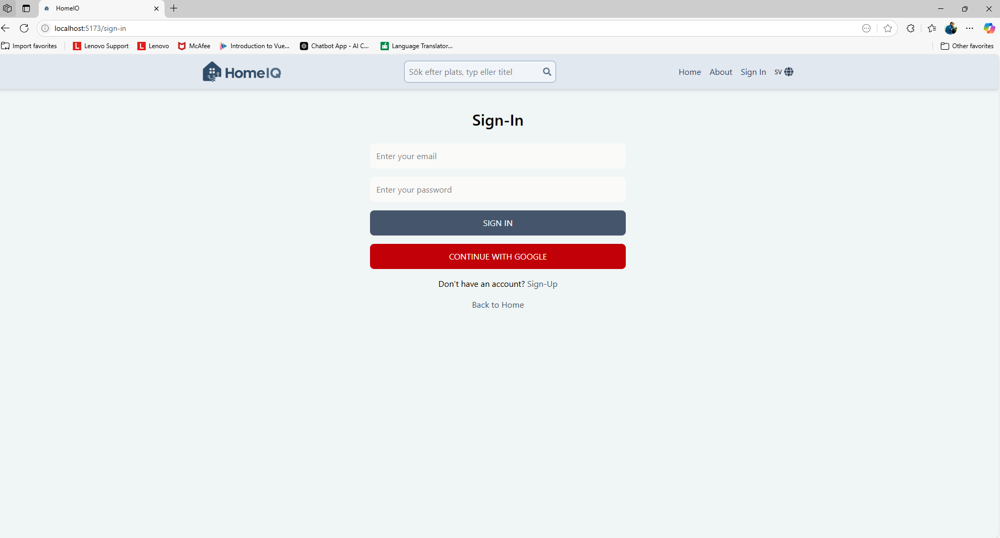
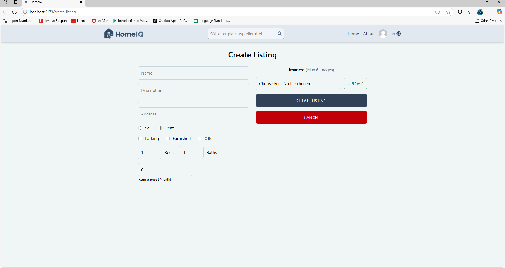
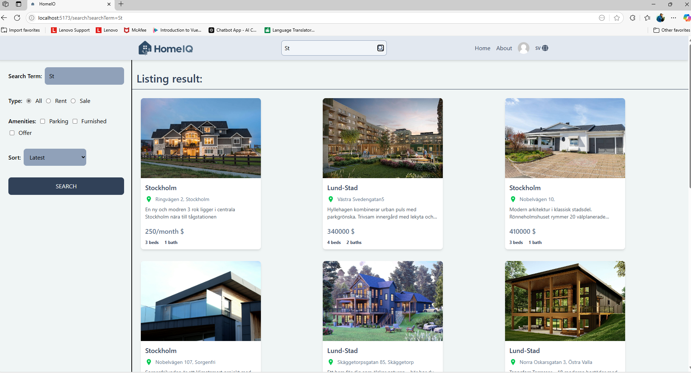

# 🏡 Homeiq – A Modern Platform for the Housing Market

**Homeiq** is a web-based platform where users can buy, sell, rent, and lease properties. Using modern technologies, the system provides a seamless experience with authentication, image management, and a user-friendly interface. The project is built with React and Vite on the frontend and Node.js/Express on the backend.

---

##  Features

Post property listings (for rent or sale)

Search for properties by location, price, and type

Sign up and log in using email or Google

Upload images to Firebase Storage

Secure authentication with JWT and Firebase Auth

Responsive design – works on both mobile and desktop

---

## 🛠️ Tech Stack

| Subsystem       | Technology                                |
|-----------------|-------------------------------------------|
| Frontend        | React, Vite                               |
| Backend         | Node.js, Express                          |
| Database        | MongoDB (via Mongoose)                    |
| Authentication  | Firebase Auth, Google OAuth, JWT          |
| Image Upload    | Firebase Storage                          |
| API-format      | REST                                      |
| State Management| (optional: e.g., React Context, Redux)    |

---

## 🔧 Installation

### Backend

```bash
git clone https://github.com/zabi-23/homeiq.git
cd homeiq
npm install
```

Add a .env file in the project root:

```env
Mongo=mongodb+srv://<ditt-URI>
JWT_SECRET=<hemlig nyckel>
FIREBASE_API_KEY=...
FIREBASE_AUTH_DOMAIN=...
FIREBASE_PROJECT_ID=...
FIREBASE_STORAGE_BUCKET=...
FIREBASE_MESSAGING_SENDER_ID=...
FIREBASE_APP_ID=...
```

 ## Run both backend and frontend (from one terminal)

  npm run dev
  
 This command uses concurrently to run both the frontend (client/) and backend (api/) servers at the same time. No need to run them separately anymore!

---

## 🧪 API-exempel

```http
POST /api/auth/register
POST /api/auth/login
GET /api/listings/
POST /api/listings/
```

> All protected routes require a JWT token in the Authorization header.

---

## 📸 Example Screenshots

### Login Page


### Listing Form


### Results Page



---


## 👤 Contact

For questions, suggestions, or collaboration:

- 📧 E-post: zabi.sideqi@gmail.com
- 🌐 Portfolio: https://lnkd.in/dS_Bc8Xh
- 💼 LinkedIn: https://www.linkedin.com/in/zabi-sideqi-4564432a0/

---
